# Class Activity 1 — System Calls in Practice

- **Student Name:** PEN Bunnaka
- **Student ID:** e20230757
- **Date:** 23 October 2026

## Task 1: File Creator & Reader

### Part A — File Creator

**Describe your implementation:**

- **Library Version (`fopen`, `fprintf`, `fclose`):** Uses standard C library abstractions that operate on buffered `FILE *` streams.
- **System Call Version (`open`, `write`, `close`):** Interfaces directly with the Linux kernel using integer file descriptors (`fd`) with no user-space buffering.

**Version A — Library Functions (`file_creator_lib.c`):**

<!-- Screenshot: gcc -o file_creator_lib file_creator_lib.c && ./file_creator_lib && cat output.txt -->
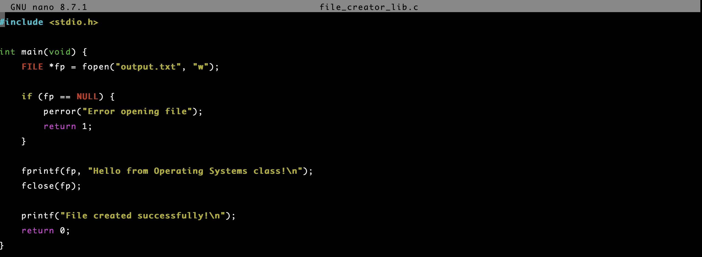

**Version B — POSIX System Calls (`file_creator_sys.c`):**

<!-- Screenshot: gcc -o file_creator_sys file_creator_sys.c && ./file_creator_sys && cat output.txt -->
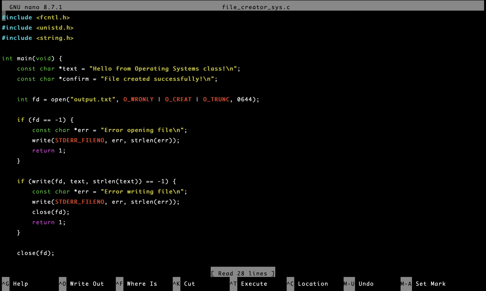

**Questions:**

1. **What flags did you pass to `open()`? What does each flag mean?**

   > - `O_WRONLY`: Open file for write-only access.
   > - `O_CREAT`: Create the file if it does not already exist.
   > - `O_TRUNC`: Truncate (overwrite) the file to zero length if it already exists.

2. **What is `0644`? What does each digit represent?**

   > `0644` defines file permissions in octal format:
   > - `0`: Specifies octal notation.
   > - `6` (4+2): Owner has Read + Write permissions.
   > - `4`: Group has Read-only permission.
   > - `4`: Others have Read-only permission.

3. **What does `fopen("output.txt", "w")` do internally that you had to do manually?**

   > Internally, `fopen("output.txt", "w")` sets equivalent flags (`O_WRONLY | O_CREAT | O_TRUNC`), applies default creation permissions, and allocates a user-space `FILE` structure with internal I/O buffering. In system calls, we manually pass flags, define octal permissions (`0644`), and manage the raw integer file descriptor.

### Part B — File Reader & Display

**Describe your implementation:**

- **Library Version (`fopen`, `fgets`, `fclose`):** Reads text line-by-line into a buffer and prints using `printf()`.
- **System Call Version (`open`, `read`, `write`, `close`):** Directly reads chunks of bytes into a 256-byte buffer via `read()` and writes them directly to `STDOUT_FILENO` (fd `1`) using `write()`.

**Version A — Library Functions (`file_reader_lib.c`):**

**Version B — POSIX System Calls (`file_reader_sys.c`):**

**Questions:**

1. **What does `read()` return? How is this different from `fgets()`?**

   > - `read()` returns the number of raw bytes actually read (`ssize_t`), `0` on EOF, or `-1` on error.
   > - `fgets()` reads line-by-line, appends a null terminator (`\0`), and returns a pointer to the buffer (`char*`), or `NULL` on EOF/error.

2. **Why do you need a loop when using `read()`? When does it stop?**

   > - A loop is required because `read()` processes data in chunks up to the buffer size; larger files require multiple reads.
   > - The loop stops when `read()` returns `0`, which signals End-of-File (EOF).

---

## Task 2: Directory Listing & File Info

**Describe your implementation:**

- **Library Version (`dir_list_lib.c`):** Uses `opendir()`, `readdir()`, and `stat()` with standard `printf()` to output formatted file names and sizes.
- **System Call Version (`dir_list_sys.c`):** Uses `snprintf()` to format directory entry metadata into a string buffer, then writes directly to stdout (`fd 1`) with `write()`.

### Version A — Library Functions (`dir_list_lib.c`)

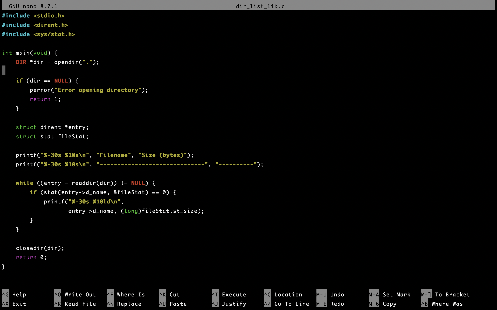

### Version B — System Calls (`dir_list_sys.c`)

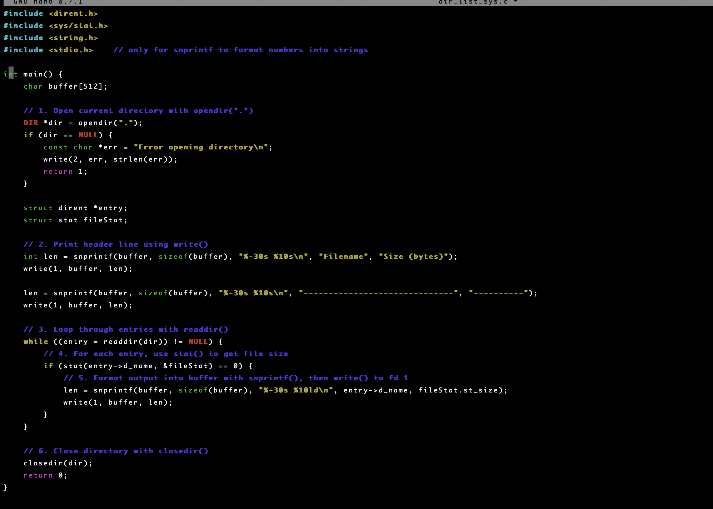

### Questions

1. **What struct does `readdir()` return? What fields does it contain?**

   > Returns a pointer to `struct dirent`. Key fields include:
   > - `d_name`: Name of the file/directory.
   > - `d_ino`: Inode number.
   > - `d_type`: Entry type (e.g., regular file `DT_REG`, directory `DT_DIR`).
   > - `d_reclen`: Record length.

2. **What information does `stat()` provide beyond file size?**

   > `struct stat` provides comprehensive file metadata, including file type/permissions (`st_mode`), user ID (`st_uid`), group ID (`st_gid`), hard link count (`st_nlink`), and timestamps for access (`st_atime`), modification (`st_mtime`), and inode status change (`st_ctime`).

3. **Why can't you `write()` a number directly — why do you need `snprintf()` first?**

   > `write()` expects a buffer containing ASCII/UTF-8 character bytes to display on the terminal. An integer in memory is stored in binary representation; `snprintf()` converts binary numeric values into printable ASCII text before writing to stdout.

---

## Optional Bonus: Windows API (`file_creator_win.c`)

Screenshot of running on Windows:

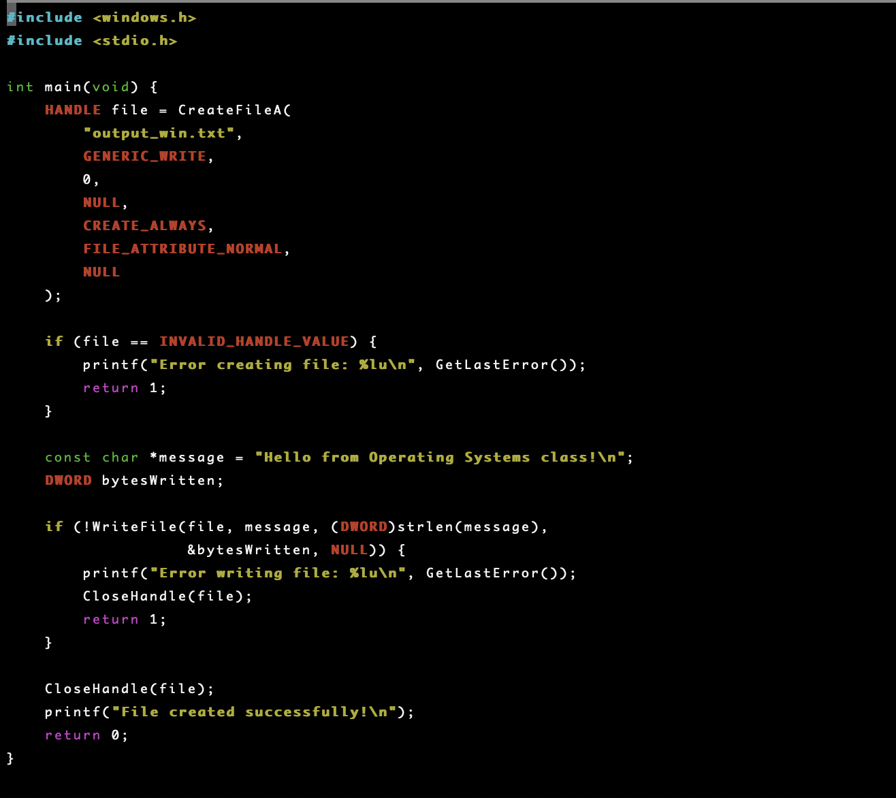

### Bonus Questions

1. **Why does Windows use `HANDLE` instead of integer file descriptors?**

   > A `HANDLE` is an opaque pointer/reference to kernel executive objects. Unlike simple integer indices in a process file table, `HANDLE` provides access to diverse kernel resources (files, processes, events, mutexes) with built-in security, access rights, and object typing.

2. **What is the Windows equivalent of POSIX `fork()`? Why is it different?**

   > The equivalent is `CreateProcess()`. POSIX `fork()` duplicates the parent's entire address space and execution state to create a child process. In contrast, `CreateProcess()` starts a new process from scratch by loading an executable file into a fresh address space.

3. **Can you use POSIX calls on Windows?**

   > Yes, through compatibility layers like Cygwin, MSYS2, or virtualization environments like WSL (Windows Subsystem for Linux).

### Cross-Platform Comparison Table

| Operation | C Library | POSIX System Call (Linux) | Windows API |
|-----------|-----------|--------------------------|-------------|
| Create/open file | `fopen()` | `open()` | `CreateFile()` |
| Write to file | `fprintf()` | `write()` | `WriteFile()` |
| Read from file | `fread()` | `read()` | `ReadFile()` |
| Close file | `fclose()` | `close()` | `CloseHandle()` |
| Delete file | `remove()` | `unlink()` | `DeleteFile()` |
| Print to console | `printf()` | `write(1, ...)` | `WriteFile(GetStdHandle(...), ...)` |

---

## Task 3: strace Analysis

**Describe what you observed:**
The library version made significantly more system calls (38 calls vs 33 calls in `strace -c`) due to standard C runtime overhead, memory allocation (`brk`), and file status checks (`fstat`). The system call version executed direct, unbuffered operations with fewer total syscalls.

### strace Output — Library Version (File Creator)

<!-- Screenshot: strace -e trace=openat,read,write,close ./file_creator_lib -->
<!-- IMPORTANT: Highlight/annotate the key system calls in your screenshot -->
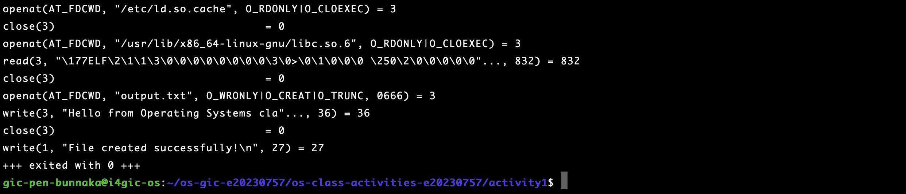

### strace Output — System Call Version (File Creator)

<!-- Screenshot: strace -e trace=openat,read,write,close ./file_creator_sys -->
<!-- IMPORTANT: Highlight/annotate the key system calls in your screenshot -->
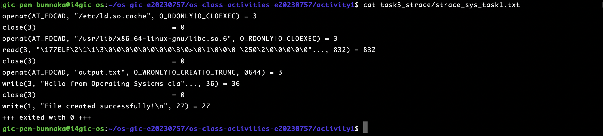

### strace Output — Library Version (File Reader or Dir Listing)

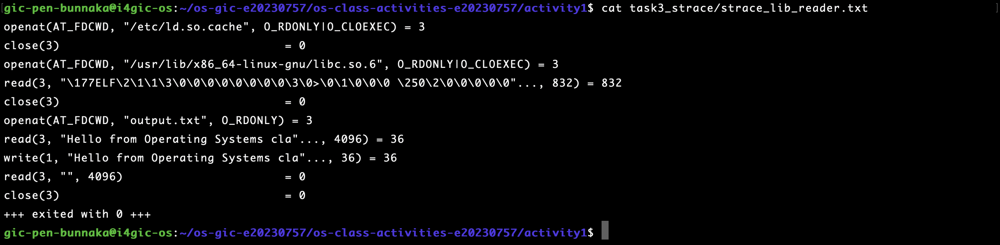

### strace Output — System Call Version (File Reader or Dir Listing)

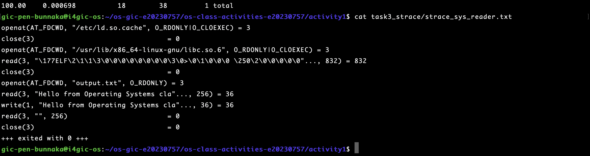

### strace -c Summary Comparison

<!-- Screenshot of `strace -c` output for both versions -->
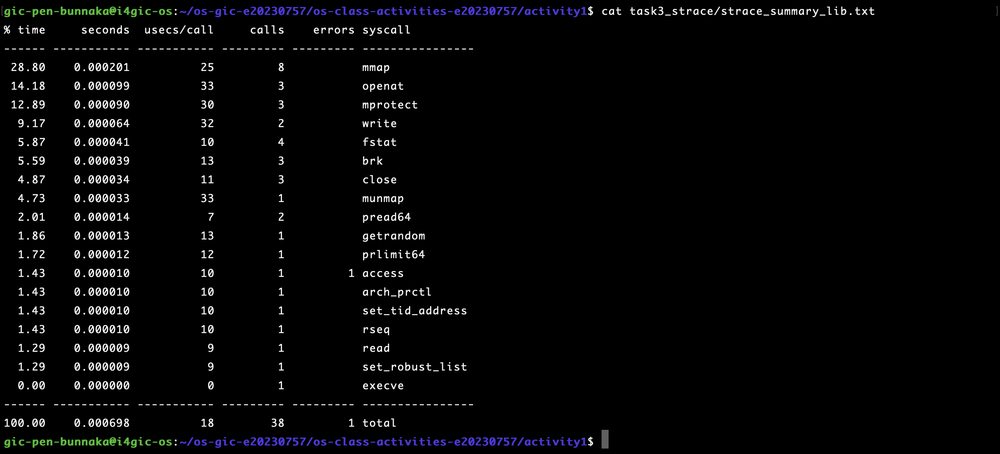
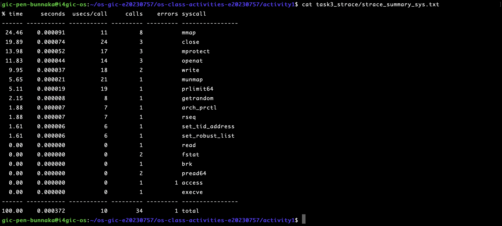

### Questions

1. **How many system calls does the library version make compared to the system call version?**

   > Based on `strace -c`:
   > - **Library Version (`file_creator_lib`):** 38 system calls total.
   > - **System Call Version (`file_creator_sys`):** 33 system calls total (5 fewer calls).

2. **What extra system calls appear in the library version? What do they do?**

   > - `fstat` (4 calls in lib vs 2 in sys): Queries file descriptors to inspect device type and determine buffer size/strategy.
   > - `brk` (3 calls in lib vs 1 in sys): Dynamically adjusts the process heap boundary for standard library I/O buffer allocation.

3. **How many `write()` calls does `fprintf()` actually produce?**

   > `fprintf()` produced exactly **1** `write()` system call (`write(3, "Hello from Operating Systems cla"..., 36) = 36`). This is because `stdio` buffers output in user space and only triggers a single flush to kernel space when `fclose()` is called.

4. **In your own words, what is the real difference between a library function and a system call?**

   > A **library function** (e.g., `printf`, `fopen`) executes in user mode within the application's address space, providing buffering, data formatting, and abstraction. A **system call** (e.g., `write`, `open`) transitions execution from user mode to kernel mode via a software interrupt/trap to request privileged OS kernel services.

---

## Task 4: Exploring OS Structure

### System Information

> 📸 Screenshot of `uname -a`, `/proc/cpuinfo`, `/proc/meminfo`, `/proc/version`, `/proc/uptime`:

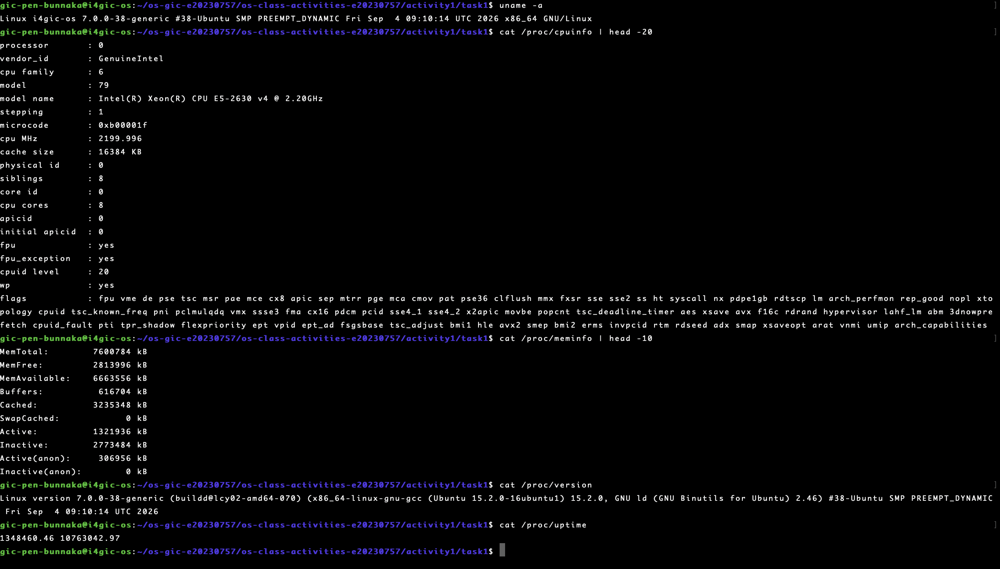

### Process Information

> 📸 Screenshot of `/proc/self/status`, `/proc/self/maps`, `ps aux`:

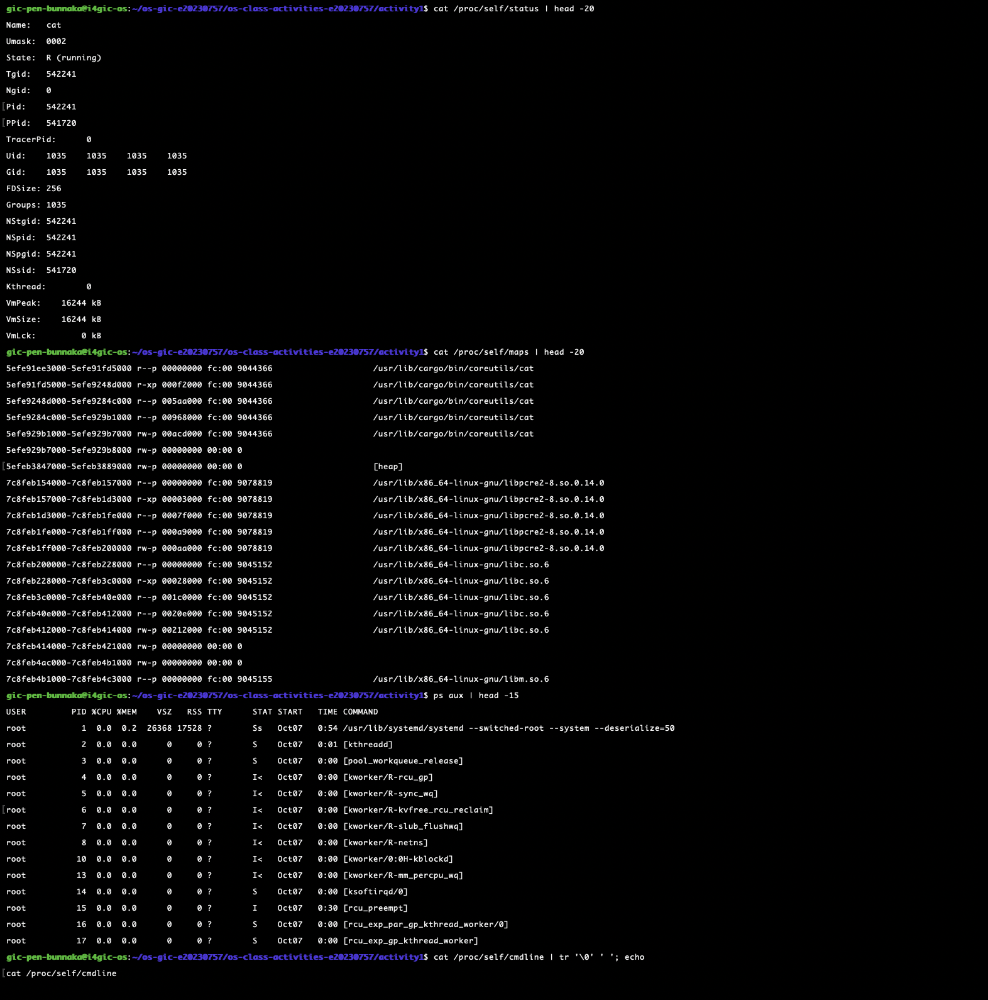

### Kernel Modules

> 📸 Screenshot of `lsmod` and `modinfo`:

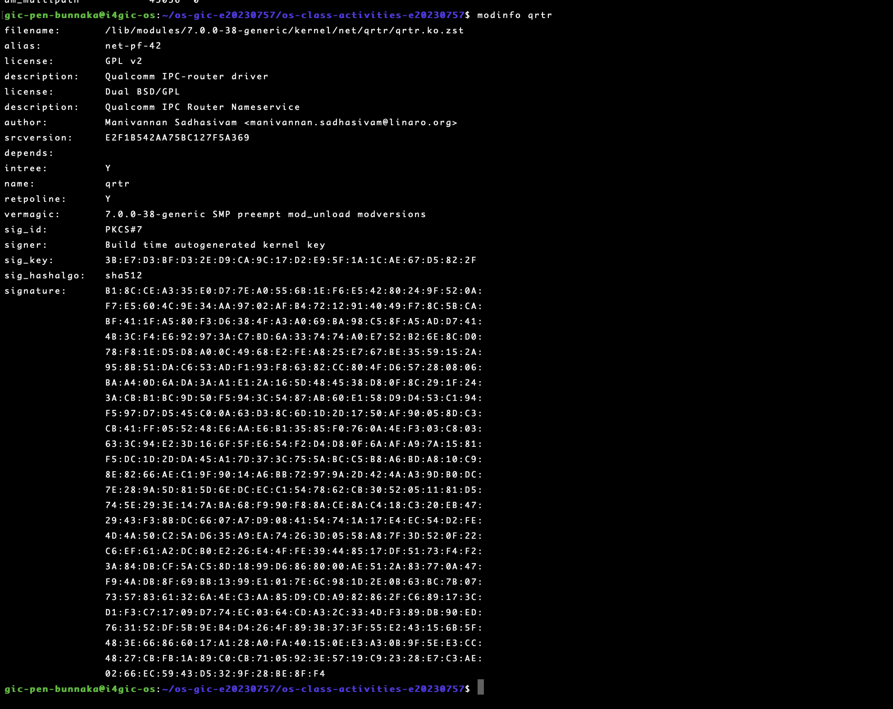

### OS Layers Diagram

> 📸 Your diagram of the OS layers, labeled with real data from your system:

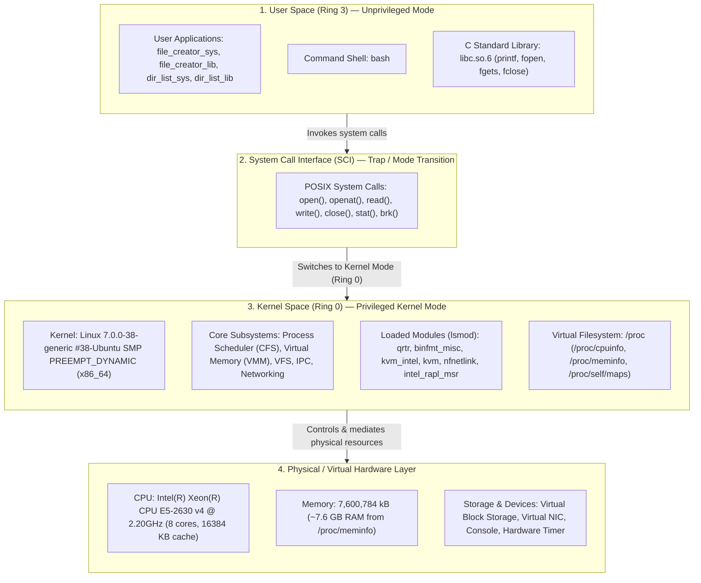

### Questions

1. **What is `/proc`? Is it a real filesystem on disk?**

   > `/proc` is a virtual (pseudo) filesystem created in memory (RAM) by the Linux kernel. It is not stored on a physical storage disk; the kernel dynamically generates its files and contents when read to expose real-time kernel state, hardware information, and running process data.

2. **Monolithic kernel vs. microkernel — which type does Linux use?**

   > - **Monolithic Kernel:** Core OS services (scheduling, memory management, filesystems, device drivers) run in a single shared, privileged address space (Ring 0).
   > - **Microkernel:** Keeps minimal functionality in kernel space (IPC, basic scheduling) and runs most services in user space.
   > - **Linux:** Uses a **monolithic kernel** that supports dynamic Loadable Kernel Modules (LKMs) via `lsmod`.

3. **What memory regions do you see in `/proc/self/maps`?**

   > - Executable text segment (`r-xp`) containing machine instructions
   > - Read-only (`r--p`) and read-write (`rw-p`) data segments
   > - `[heap]` for dynamic heap memory allocations (`malloc`/`brk`)
   > - Shared libraries (`libc.so.6`, `ld-linux-x86-64.so.2`)
   > - `[stack]` for function frames, local variables, and return pointers
   > - `[vvar]` and `[vdso]` kernel virtual pages for fast system calls

4. **Break down the kernel version string from `uname -a`.**

   > Based on `uname -a` (`7.0.0-38-generic #38-Ubuntu SMP PREEMPT_DYNAMIC x86_64`):
   > - `7`: Major kernel version
   > - `0`: Minor kernel release
   > - `0`: Patch level
   > - `-38`: Distribution ABI / build revision number
   > - `-generic`: Ubuntu kernel configuration flavor
   > - `#38-Ubuntu`: Official distro build number
   > - `SMP PREEMPT_DYNAMIC`: Symmetric Multiprocessing with dynamic preemption
   > - `x86_64`: 64-bit CPU architecture

5. **How does `/proc` show that the OS is an intermediary between programs and hardware?**

   > User programs cannot directly access hardware registers or memory controllers due to CPU privilege ring protection. The OS kernel queries the physical hardware, abstracts the raw state into structured virtual text files in `/proc` (such as `/proc/cpuinfo` and `/proc/meminfo`), and provides unprivileged user programs a safe, standard file read interface to inspect system hardware.

---

## Reflection

What did you learn from this activity? What was the most surprising difference between library functions and system calls?

> Through this activity, I learned that C standard library functions (like `printf` and `fopen`) are user-space abstractions with internal buffering that operate on top of low-level POSIX system calls (`write`, `open`, `read`, `close`). Tracing with `strace` revealed the true boundary between user space and kernel space, showing how library functions reduce overhead by batching multiple I/O operations into fewer system calls. Exploring `/proc` further clarified how the operating system manages process memory maps and mediates access to hardware resources.